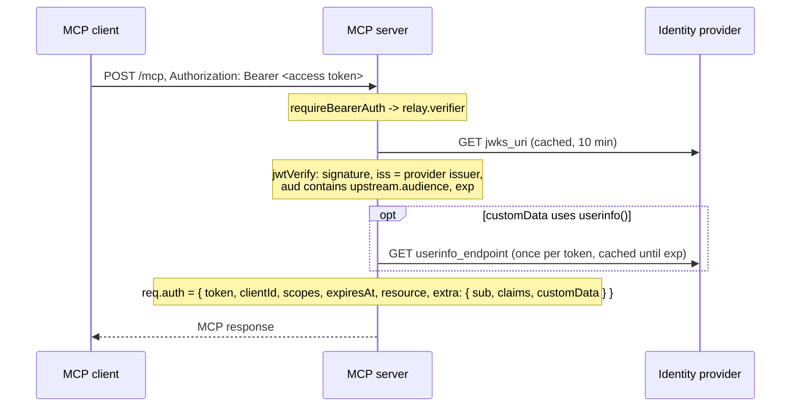

# Architecture

How `mcp-oidc-provider` turns an MCP server into an OAuth 2.1 protected resource whose authorization server is a relay in front of an OpenID Connect identity provider.

## Roles

| Party | Role | Implemented by |
| --- | --- | --- |
| MCP client (Claude, Cursor, VS Code, Inspector, ...) | OAuth 2.1 public client | the client |
| MCP server (`/mcp`) | OAuth 2.1 resource server | your app + `relay.verifier` via `requireBearerAuth` |
| Relay (same origin as the MCP server) | Authorization server towards MCP clients, confidential client towards the identity provider | `relay.router` |
| Identity provider (Auth0, Okta, Keycloak, Entra ID, ...) | Authenticates users, mints every token | the provider |

The relay never mints tokens. Towards the MCP client it looks like an authorization server (metadata, registration, `/authorize`, `/token`); towards the identity provider it is one registered web application with a fixed callback URL. From the provider's point of view every field it validates (client ID, secret, redirect URI, code, PKCE verifier) belongs to the relay, which is the standard proxy / backend-for-frontend arrangement, not a token-minting intermediary.

## Modules

```
src/
  index.ts                   public API
  types.ts                   option types
  relay/
    create-auth-relay.ts     composes router, verifier, metadata
    metadata.ts              authorization server metadata document
    clients.ts               ClientRegistry: DCR, Client ID Metadata Documents, redirect URI policy, client auth
    authorize.ts             GET /authorize, POST /authorize/consent, GET /oauth/callback
    token.ts                 POST /token
    upstream.ts              Upstream: discovery, authorization URL, token endpoint, UserInfo, JWKS
    verifier.ts              OAuthTokenVerifier for the MCP SDK
    consent.ts               ConsentStore: signed cookie of approvals
    html.ts                  consent and error pages
    storage.ts               namespaced Keyv views, random ids, hashing
    errors.ts                OAuthRequestError and response helpers
  express/cors.ts            CORS for the MCP endpoint
```

## Flows

### 1. Discovery and client registration

```mermaid
sequenceDiagram
    participant C as MCP client
    participant S as MCP server + relay
    C->>S: POST /mcp (no token)
    S-->>C: 401, WWW-Authenticate: Bearer resource_metadata="https://mcp.example.com/.well-known/oauth-protected-resource/mcp"
    C->>S: GET /.well-known/oauth-protected-resource/mcp
    S-->>C: { resource, authorization_servers: ["https://mcp.example.com"], scopes_supported }
    C->>S: GET /.well-known/oauth-authorization-server
    S-->>C: { issuer, authorization_endpoint, token_endpoint, registration_endpoint, code_challenge_methods_supported: ["S256"], client_id_metadata_document_supported: true, ... }
    alt Client ID Metadata Document
        Note over C,S: client_id is an https URL; the relay fetches it at /authorize
    else Dynamic Client Registration
        C->>S: POST /register { redirect_uris, client_name, token_endpoint_auth_method, grant_types }
        S-->>C: 201 { client_id, client_id_issued_at, ...metadata }
    end
```

Both discovery documents are served by the MCP SDK's `mcpAuthMetadataRouter` from a document the relay builds locally (`metadata.ts`); no request to the identity provider is needed for them.

Dynamic registrations are validated against RFC 7591 (`clients.ts`): `redirect_uris` must pass the redirect URI policy, `response_types` must be `["code"]`, `grant_types` may be `authorization_code` with or without `refresh_token`, and `token_endpoint_auth_method` may be `none` (the default), `client_secret_basic` or `client_secret_post`. Confidential clients receive a secret once; only its SHA-256 is stored. Registrations expire after `clients.registrationTtl` (30 days); a client whose registration expired gets `invalid_client` and re-registers.

Client ID Metadata Documents are resolved when the `client_id` is first seen: the URL must be `https` with a path and a public hostname (or one in `cimdAllowedHosts`), the hostname must not resolve to a private address, the response must be a 200 with a JSON object of at most 64 KB whose `client_id` equals the URL, and its `redirect_uris` must pass the same policy. Such clients are always public. The validated document is cached in Keyv for `Cache-Control: max-age`, clamped between one minute and `clients.cimdCacheTtl`.

### 2. Authorization

```mermaid
sequenceDiagram
    participant B as Browser
    participant C as MCP client
    participant S as Relay
    participant P as Identity provider
    C->>B: open /authorize?client_id&redirect_uri&response_type=code&code_challenge&code_challenge_method=S256&state&scope&resource
    B->>S: GET /authorize
    Note over S: resolve client, match redirect_uri exactly,<br/>require S256 PKCE, check resource
    alt no remembered approval for (client_id, redirect_uri)
        S-->>B: 200 consent page (client name, client_id, redirect URI host, scopes)
        B->>S: POST /authorize/consent { id, csrf, decision }
        Note over S: csrf must match the stored interaction;<br/>Origin, if present, must be the relay
        S-->>B: Set-Cookie: mcp_relay_consent (signed, per client + redirect URI)
    end
    Note over S: store PendingAuthorization under state:<random>, 10 min
    S-->>B: 302 P/authorize?client_id=<relay>&redirect_uri=<relay>/oauth/callback&code_challenge=<client's>&audience=...&state=<random>
    B->>P: sign in
    P-->>B: 302 <relay>/oauth/callback?code=<upstream code>&state=<random>
    B->>S: GET /oauth/callback
    Note over S: consume state; store record + upstream code<br/>under code:<relay code>, 5 min
    S-->>B: 302 redirect_uri?code=<relay code>&state=<client's>&iss=<relay>
    B->>C: callback
```

Errors about the client or the redirect URI are shown as an HTML page and never redirect (RFC 6749 section 4.1.2.1). Every other error is redirected to the client with `error`, `error_description`, `state` and `iss`. Errors the identity provider returns to the callback (`access_denied`, `login_required`, ...) are relayed the same way.

The PKCE challenge the MCP client created is the one the identity provider sees. The relay never learns the verifier before the token request and never computes a challenge of its own.

### 3. Token exchange and refresh

```mermaid
sequenceDiagram
    participant C as MCP client
    participant S as Relay
    participant P as Identity provider
    C->>S: POST /token grant_type=authorization_code&code=<relay code>&code_verifier&redirect_uri&client_id (+ client_secret or Basic)
    Note over S: authenticate client; consume code:<relay code>;<br/>client and redirect_uri must match the record
    S->>P: POST token_endpoint grant_type=authorization_code&code=<upstream code>&redirect_uri=<relay>/oauth/callback&code_verifier=<client's> (Basic <relay credentials>)
    Note over P: verifies the PKCE verifier against the challenge from /authorize
    P-->>S: { access_token, refresh_token, id_token, expires_in, scope }
    S-->>C: same body, Cache-Control: no-store
    C->>S: POST /token grant_type=refresh_token&refresh_token&client_id
    S->>P: POST token_endpoint grant_type=refresh_token&refresh_token (Basic <relay credentials>)
    P-->>S: new tokens
    S-->>C: same body
```

Before a successful response is sent, the relay verifies the ID token (against the provider's keys, or the client secret for `HS*` algorithms) and the access token in it and passes their claims to the `onTokenResponse` hook, so applications can persist data that only the ID token carries. The tokens themselves are not passed, and a failing hook is logged, not surfaced to the client.

The provider's `2xx` and `400` responses are returned as they are (so `invalid_grant` for a wrong verifier reaches the client untouched). A `401`/`403` from the provider means the relay's own credentials are wrong and is reported as `502 server_error`; `5xx` becomes `502 temporarily_unavailable`. Grant types other than `authorization_code` and `refresh_token` are refused with `unsupported_grant_type` before anything is forwarded: forwarding, say, `client_credentials` with the relay's secret would let any MCP client act as the relay.

### 4. Requests to the MCP endpoint



The verifier reports `AuthInfo.resource` as the MCP endpoint URL once the audience check passed, so `requireBearerAuth({ expectedResource: relay.resource })` works without the provider knowing the MCP URL. Any failure, including a throwing `customData`, becomes the SDK's `OAuthError(invalid_token)` and a `401` challenge that points clients back to the resource metadata.

## Data in Keyv

All keys are written through the caller's store with these namespaces:

| Namespace | Key | Value | Lifetime |
| --- | --- | --- | --- |
| `mcp-relay:clients` | `client_id` | registration (`redirect_uris`, `client_name`, auth method, `client_secret_hash`, ...) | `clients.registrationTtl` |
| `mcp-relay:cimd` | `client_id` URL | validated metadata document | `Cache-Control`, at most `clients.cimdCacheTtl` |
| `mcp-relay:pending` | `consent:<id>` | authorization request waiting for the consent decision + CSRF token | 10 minutes |
| `mcp-relay:pending` | `state:<state>` | authorization request forwarded to the provider | 10 minutes |
| `mcp-relay:pending` | `code:<relay code>` | the same request plus the provider's code | 5 minutes |

Records are deleted when consumed. Nothing in the store can be exchanged for a token without also holding the MCP client's PKCE verifier (and, for confidential clients, its secret), and nothing in it outlives a sign-in.

## Security considerations

- **Compromised MCP server.** There is no signing key to forge tokens with and no token store to read. An attacker in the process sees the tokens of requests made while they are present and the relay's client secret; the secret alone cannot obtain a user token when the provider's client credentials grant is disabled for the relay's application. Rotating the secret ends the exposure.
- **Confused deputy.** Because the provider sees one client for all MCP clients, a remembered provider-side approval would let a malicious client obtain codes silently. The relay asks the user per `(client_id, redirect_uri)` and binds the approval to a cookie signed with a key derived from the upstream client secret (`consent.secret` overrides it), so instances share approvals without sharing new state.
- **Code injection and theft.** The relay code is random, single use, bound to the client and redirect URI, and useless without the PKCE verifier that only the MCP client holds. The upstream code never reaches the client.
- **Open redirects.** Redirect URIs must match the registration exactly (loopback IP literals may vary the port, OAuth 2.1 section 8.4.2), and errors about them are never redirected.
- **CSRF on the consent form.** The decision is accepted only with the one-time token embedded in the page for that interaction, and only from the relay's own origin when the browser sends `Origin`.
- **Metadata document fetches (SSRF).** See the checks listed under client registration; `cimdAllowedHosts` turns the feature into an allowlist.
- **Audience.** Tokens are accepted only if `aud` contains `upstream.audience`, so tokens the provider issued for other APIs are refused even though the same user signed in. If other services accept the same audience, forwarding the MCP client's token to them is token passthrough; prefer a dedicated audience for the MCP server.
- **Transport.** Consent cookies are `HttpOnly`, `SameSite=Lax`, scoped to `/authorize` and `Secure` for `https` base URLs. Serve the relay over HTTPS.

## Deployment

- Mount `relay.router` at the root of the app that serves `baseUrl`; the well-known paths and the callback must live at the origin's root.
- Run as many instances as you like. State lives in Keyv and in signed cookies; the consent cookie key derives from the upstream client secret, so instances agree without extra configuration. No sticky sessions are needed.
- The identity provider's metadata is discovered on first use and cached for the process lifetime; call `relay.discoverUpstream()` at startup to fail fast on misconfiguration. Discovery failures are retried on the next request.
- Put a rate limiter in front of `/register` and `/token`.

## Limitations

- Access tokens must be JWTs (RFC 9068 or provider-specific) verifiable with the provider's JWKS. Opaque access tokens are rejected.
- No revocation or introspection endpoints are exposed; no DPoP or other sender constraints (MCP clients do not support them yet).
- Refresh tokens are issued to the relay's single upstream client; the relay cannot attribute a refresh token to a particular MCP client. Enable refresh token rotation with reuse detection at the provider.
- The relay's issuer must be an origin without a path.
